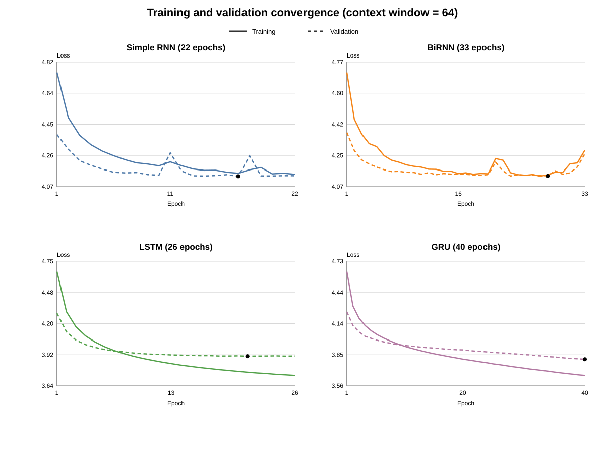
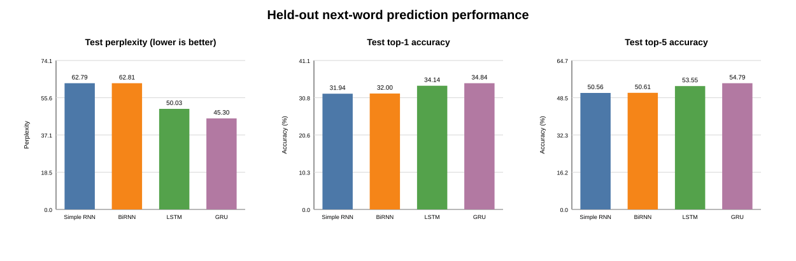
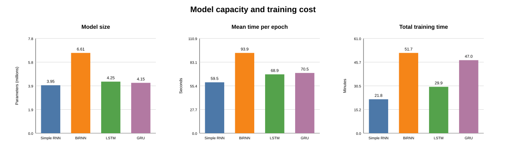
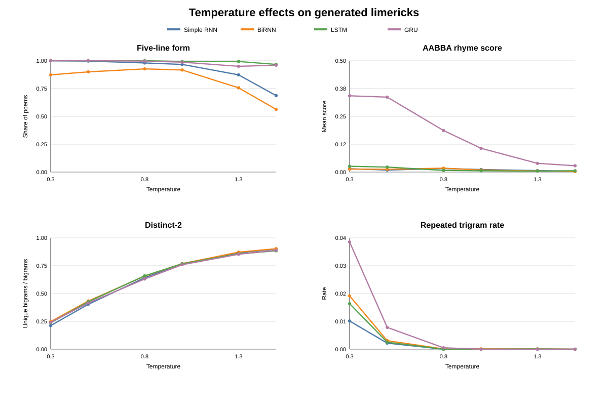
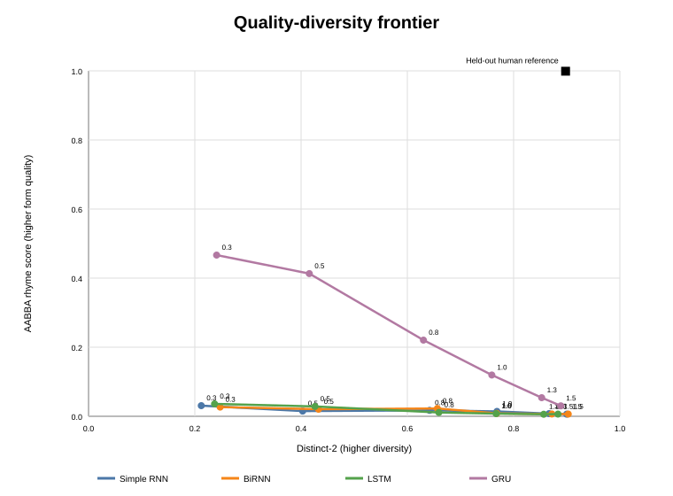
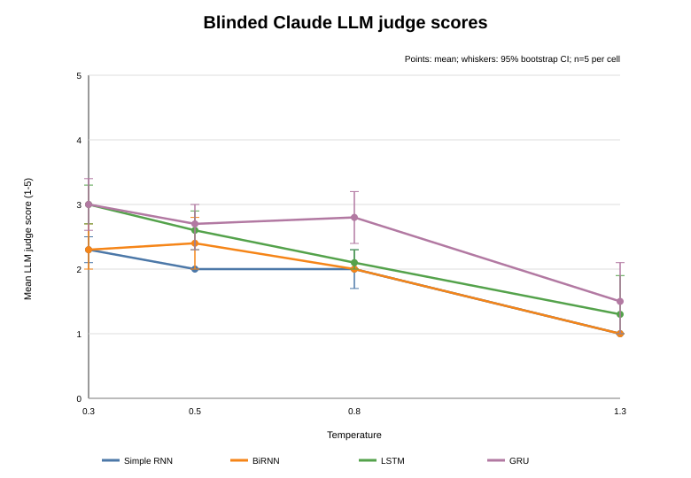

# Word Level Limerick Generation with RNN LSTM and GRU

## Objective

This project implements and compares four word-level autoregressive language models for the ICT4403 Foundations of Generative AI Assignment 2: a Simple RNN, a Bidirectional RNN, an LSTM, and a GRU. Each model predicts the next token from a 64-token context and then generates limerick-like text sequentially from shared seed prompts.

The final recommendation is **GRU at temperature 0.3**. It achieved the best held-out prediction metrics and the strongest automated AABBA-rhyme result among generated samples, while retaining the best manual contextual-consistency score.

## Dataset

The experiments use the [Limerick Dataset (OEDILF v3)](https://doi.org/10.5281/zenodo.5722527), hosted on Zenodo under [CC BY 3.0 US](https://creativecommons.org/licenses/by/3.0/us/). The final run filtered the full source to 65,886 limericks, split by poem into 80% train, 10% validation, and 10% test sets. See [data/README.md](data/README.md) for download instructions and a content note.

## Models and common training protocol

All models used the same full dataset split, seed (42), vocabulary cap (10,000), 128-dimensional embeddings, 256 hidden units, dropout 0.3, Adam learning rate 0.001, batch size 512, and a 64-token context window. Early stopping used validation loss with patience 5 and a maximum of 40 epochs. The best validation checkpoint was evaluated once on the held-out test set.

| Model | Parameters | Epochs | Test perplexity | Top-1 | Top-5 | Training time |
|---|---:|---:|---:|---:|---:|---:|
| Simple RNN | 3.95M | 22 | 62.79 | 31.94% | 50.56% | 21.8 min |
| BiRNN | 6.61M | 33 | 62.81 | 32.00% | 50.61% | 51.7 min |
| LSTM | 4.25M | 26 | 50.03 | 34.14% | 53.55% | 29.9 min |
| GRU | 4.15M | 40 | **45.30** | **34.84%** | **54.79%** | 47.0 min |

The GRU reached the 40-epoch cap while its validation loss was still improving. The Simple RNN, BiRNN, and LSTM stopped earlier under the shared early-stopping rule; this is a limitation when interpreting total training time and fixed-epoch comparisons.

## Results and figures

The training histories, test metrics, generated samples, and figures are committed under `results/`.







## Temperature study and generated-text evaluation

The generation sweep contains 7,200 poems: 4 models x 6 temperatures (0.3, 0.5, 0.8, 1.0, 1.3, 1.5) x 300 samples. Five fixed prompts were balanced within each model-temperature cell. Evaluation includes termination, exact five-line form, CMU-dictionary rhyme coverage and AABBA rhyme score, repeated-trigram rate, immediate repeats, training-line copying, distinct-1/2/3, and unique-poem share. Confidence intervals are 95% bootstrap percentile intervals (2,000 resamples).

At low temperature, the GRU had the strongest form result: at temperature 0.3, its exact-five-line rate was 100% and its AABBA rhyme score was 46.7%. Higher temperature consistently increased lexical diversity but reduced rhyme adherence and, for the vanilla RNNs, five-line form.





## Blinded manual scoring

An 80-poem blinded sample (4 models x 4 temperatures x 5 poems) was rated on 1-5 coherence and contextual consistency. GRU at temperature 0.3 had the strongest combined manual score (3.0/5, 95% bootstrap CI 2.6-3.4), tied in point estimate with LSTM at temperature 0.3. The automated rhyme and held-out prediction evidence selects GRU at temperature 0.3 overall. Because each manual cell has five poems and one rater, differences with overlapping intervals are interpreted cautiously.



## Reproduction

1. Create a Python environment and install dependencies:

   ```powershell
   python -m pip install -r requirements.txt
   ```

2. Download the dataset as described in `data/README.md`.
3. Train one model (example):

   ```powershell
   python src/train_simple_rnn.py --data data/limerick_dataset_oedilf_v3.json --model-kind gru --context 64 --epochs 40 --patience 5 --output results/final_context64_gru
   ```

4. Verify checkpoints, recreate figures, run the sweep, and evaluate it:

   ```powershell
   python src/verify_final_checkpoints.py --data data/limerick_dataset_oedilf_v3.json
   python src/create_final_figures.py
   python src/run_generation_sweep.py --data data/limerick_dataset_oedilf_v3.json
   python src/evaluate_generation_sweep.py --data data/limerick_dataset_oedilf_v3.json
   python src/create_sweep_figures.py
   ```

Checkpoints and the raw dataset are intentionally excluded from version control because of their size. The committed JSON, CSV, SVG, and Markdown artefacts contain the reported evidence.

## Limitations

- One random seed was used.
- Models trained for different numbers of epochs because of validation-based early stopping.
- GRU still improved at the maximum epoch cap.
- The rhyme metric only checks line-ending words covered by the CMU Pronouncing Dictionary.
- Manual scoring used one rater and five poems per cell.
- Perplexity measures next-token prediction rather than complete poetic quality.

## Repository contents

- `src/`: training, verification, sweep, evaluation, and figure scripts.
- `results/final_context64_*`: final metrics, histories, vocabulary files, and showcase samples.
- `results/figures/`: quantitative training figures and table.
- `results/sweep/`: raw generations, automatic metrics, manual-score outputs, and temperature figures.
- `data/README.md`: dataset provenance and download instructions.

